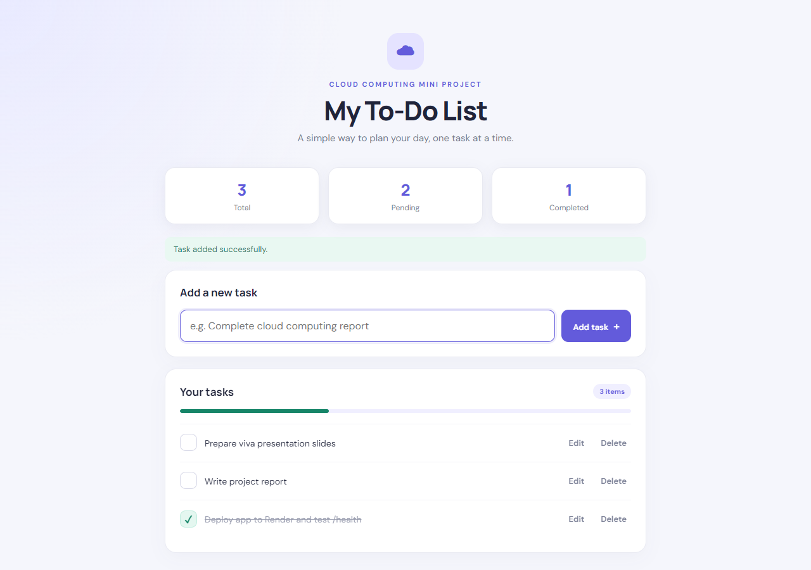
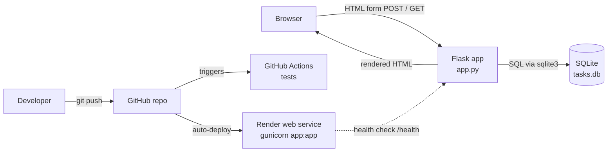

# Cloud-Based To-Do List Application

A cloud computing mini project built with Python, Flask, SQLite, HTML and CSS. It demonstrates a small server-rendered web application, source control with GitHub, automated tests with GitHub Actions, and deployment to Render.



## Problem statement
People need a simple way to keep a list of tasks and track which ones are done. This project provides a browser-based task list that runs locally and can be hosted on a public cloud URL.

## Features
- Add a task (1–200 characters, surrounding whitespace trimmed)
- Edit a task's title
- Mark a task complete or pending
- Delete a task, with a confirmation prompt
- Total, pending and completed counts, plus a progress bar
- Success and error messages after every action
- Friendly 400/404 error pages
- CSRF protection on every form
- Health endpoint at `/health` that also checks the database
- Responsive layout for desktop, tablet and mobile
- 13 automated tests, run on every push by GitHub Actions

## Technology stack
| Component | Technology | Purpose |
|---|---|---|
| Frontend | HTML (Jinja2 templates), CSS | User interface |
| Backend | Python 3.12, Flask 3 | Routes and application logic |
| Database | SQLite | Task storage |
| Production server | gunicorn | WSGI server on Render |
| Version control | Git, GitHub | Source code history |
| CI | GitHub Actions | Compile check and unit tests |
| Cloud hosting | Render | Public web deployment |

## Architecture


**Request flow.** The page is server-rendered: there is no JavaScript API. Each button is an HTML form that POSTs to Flask. Flask validates the CSRF token and the input, writes to SQLite, stores a flash message, and redirects back to `/` (the Post/Redirect/Get pattern). Refreshing the page never resubmits a form.

### Routes
| Method | Path | Purpose | Responses |
|---|---|---|---|
| GET | `/` | List tasks and counts. `?edit=<id>` shows the edit form for that task | 200 |
| POST | `/add` | Create a task from form field `title` | 302 to `/`, 400 for a bad CSRF token |
| POST | `/edit/<id>` | Change the title of a task | 302, 404 if the task is missing |
| POST | `/toggle/<id>` | Switch between complete and pending | 302, 404 if the task is missing |
| POST | `/delete/<id>` | Delete a task | 302, 404 if the task is missing |
| GET | `/health` | `{"status":"ok","database":"ok"}` | 200, or 503 if the database is unavailable |

Every POST needs the `csrf_token` form field that the page embeds. Validation errors such as an empty or too-long title are shown as flash messages after the redirect.

### Database schema
```sql
CREATE TABLE IF NOT EXISTS tasks (
    id INTEGER PRIMARY KEY AUTOINCREMENT,
    title TEXT NOT NULL,
    completed INTEGER NOT NULL DEFAULT 0,
    created_at TIMESTAMP DEFAULT CURRENT_TIMESTAMP
);
```
The table is created automatically on startup (`init_db()` in `app.py`), and existing data is kept. No separate migration step is needed.

## Project structure
```text
cloud_todo_project/
├── app.py                  # Flask app: routes, validation, CSRF, SQLite access
├── requirements.txt        # Flask, gunicorn
├── Procfile                # start command for Procfile-based hosts
├── render.yaml             # Render Blueprint (service, health check, env vars)
├── .env.example            # documented environment variables
├── templates/
│   ├── base.html           # shared layout
│   ├── index.html          # task list page
│   └── error.html          # 400/404 page
├── static/style.css        # styles and responsive layout
├── tests/test_app.py       # unit tests (unittest)
├── docs/screenshots/       # screenshots taken from the running app
├── .github/workflows/ci.yml
└── REPORT_TEMPLATE.md      # mini-project report outline
```

## Run locally (Windows PowerShell)
Prerequisite: Python 3.11 or newer (developed on 3.12).

```powershell
cd D:\cloud_todo_project
py -m venv .venv
.venv\Scripts\Activate.ps1          # if blocked: Set-ExecutionPolicy -Scope Process Bypass
python -m pip install -r requirements.txt
python app.py
```
Open http://127.0.0.1:5000.

`python app.py` serves on `0.0.0.0:5000` with debug off. For development with auto-reload and the debugger (bound to localhost only):
```powershell
$env:FLASK_DEBUG = "1"; python app.py
```

### Environment variables
See `.env.example`. The app reads real environment variables. It does **not** load a `.env` file.

| Variable | Required | Default | Purpose |
|---|---|---|---|
| `SECRET_KEY` | In production | `dev-only-change-this-key` | Signs the session cookie that holds the CSRF token |
| `DATABASE_PATH` | No | `tasks.db` next to `app.py` | SQLite file location |
| `PORT` | No | `5000` | Port for `python app.py` (gunicorn reads `PORT` too) |
| `FLASK_DEBUG` | No | off | `1` turns on the debugger. Use this locally only |

PowerShell example:
```powershell
$env:SECRET_KEY = python -c "import secrets; print(secrets.token_hex(32))"
$env:DATABASE_PATH = "D:\data\tasks.db"
python app.py
```

## Testing
```powershell
python -m unittest discover -s tests -v
```
The tests use a temporary database and never touch `tasks.db`. They cover adding a task, validation of empty and too-long titles, HTML escaping, toggling, editing, deleting, 404 for missing tasks, CSRF rejection, data persistence across `init_db()`, and both healthy and failing `/health`.

## Deploy to Render
1. Push the project to GitHub (`origin` is `https://github.com/Karmanya-Singh30/cloud-todo-app.git`).
2. In Render, choose **New + → Blueprint** and select the repository. `render.yaml` creates the web service with:
   - Build command: `pip install -r requirements.txt`
   - Start command: `gunicorn app:app` (gunicorn binds to Render's `$PORT` automatically)
   - Health check path: `/health`
   - Environment: a generated `SECRET_KEY` and `PYTHON_VERSION=3.12.3`

   To set it up by hand instead, choose **New + → Web Service** and enter the same values.
3. Open the service URL and test `/` and `/health`.

gunicorn does not run on Windows because it needs the Unix-only `fcntl` module. Locally, use `python app.py`. Render runs gunicorn on Linux.

### Data persistence on Render
Locally, tasks persist in `tasks.db` across restarts (verified). On Render's **free** plan the filesystem is ephemeral: `tasks.db` is wiped on every redeploy or restart. This is fine for a classroom demo, but data is not durable. For durable data, use one of these:
- A paid plan with a persistent disk: mount it at `/var/data` and set `DATABASE_PATH=/var/data/tasks.db`.
- Move to a managed PostgreSQL database. This needs code changes and is not implemented here.

## CI/CD
`.github/workflows/ci.yml` runs on pushes and pull requests to `main`. It installs dependencies, compiles `app.py`, and runs the unit tests. Render auto-deploys the connected branch. Check the live URL after each deploy.

## Security notes
- CSRF: each session gets a random token, which every POST must include. The session cookie is `SameSite=Lax`.
- Jinja2 escapes all task titles, so HTML and script content is shown as text (tested).
- All SQL uses parameterised queries.
- The Werkzeug debugger is opt-in (`FLASK_DEBUG=1`) and binds only to `127.0.0.1`.
- Never commit a real `SECRET_KEY` or `.env` file. `.env` and `tasks.db` are git-ignored.

## Known limitations
- Single shared list: there are no user accounts, so anyone with the URL can view and change every task.
- SQLite on Render's free plan is not durable (see above).
- No due dates, priorities, search or filters.

## Mini-project report
Use `REPORT_TEMPLATE.md` as the report outline. Screenshots of the app running locally are in `docs/screenshots/`. Add your own details, a screenshot of GitHub Actions passing, your real GitHub URL and your real deployed URL. Do not claim a deployment succeeded until you have tested the live URL.
