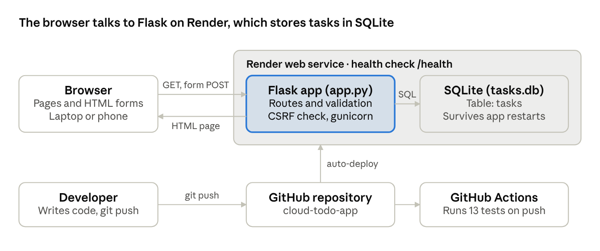
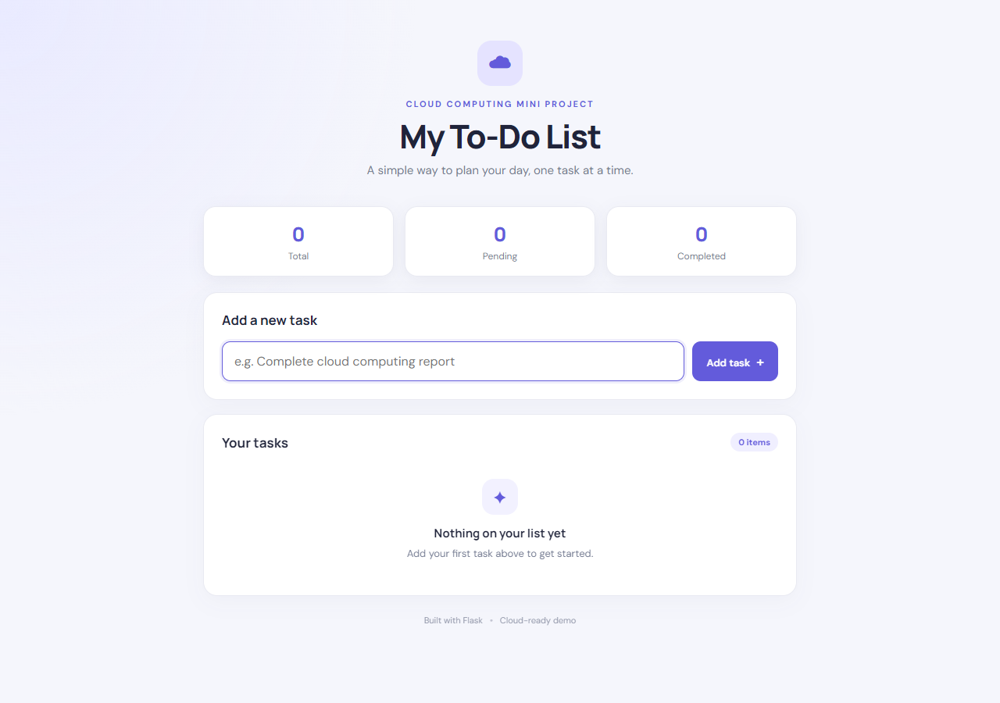
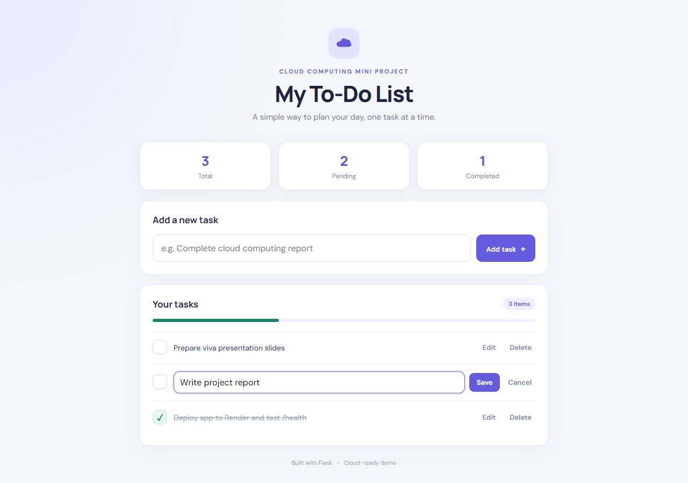
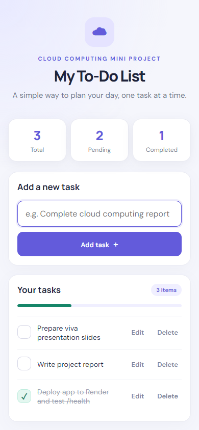
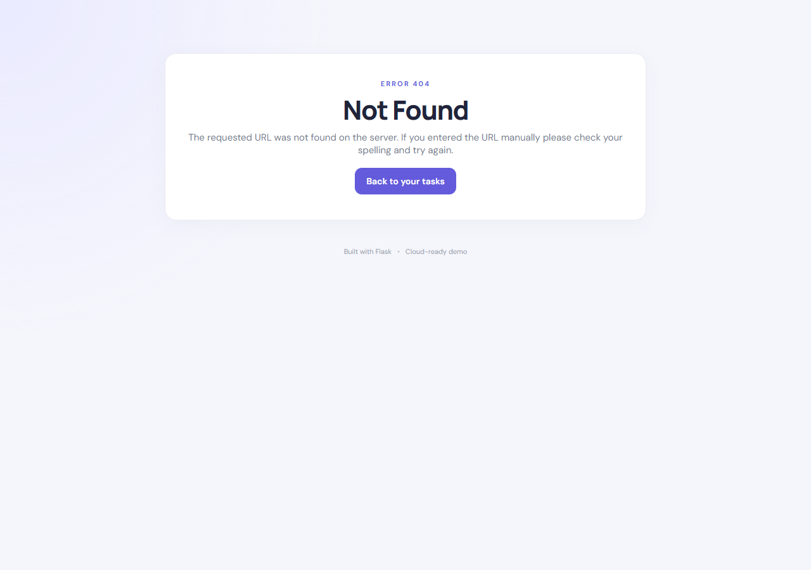

# Cloud-Based To-Do List Application — Project Report

A Flask and SQLite to-do app that lets users add, edit, complete and delete tasks, tested with 13 automated tests and configured for deployment on Render.

## Cover details

| Field | Value |
| --- | --- |
| Course | Introduction to Cloud Computing (TE7948) |
| Project title | Cloud-Based To-Do List Application |
| Student name | [Your name] |
| Roll number | [Your roll number] |
| Faculty | [Faculty name] |
| Institute | [Institute name] |
| Submission date | [Date] |
| GitHub repository | https://github.com/Karmanya-Singh30/cloud-todo-app |
| Live URL | [Add after deploying to Render] |

Replace each bracketed value with your own details before submitting.

## 1. Abstract

This project is a web-based task manager built with Python Flask, HTML, CSS and SQLite. Users can add, edit, complete and delete tasks, and see counts of total, pending and completed work.

GitHub holds the source code, and GitHub Actions runs the automated tests on every push. Render is the cloud platform, configured through `render.yaml` with a health check at `/health`.

The app protects every form against cross-site request forgery (CSRF), validates all input and escapes all output. It passes 13 automated tests and a full browser test of every user action.

## 2. Problem statement and objectives

People need a simple way to keep a list of tasks and track which ones are done. This project provides that list in a browser, served from the cloud so it can be reached from any device with the URL.

Objectives:

1. Build a small, modular web application with Flask.
2. Implement creating, reading, updating and deleting tasks (CRUD).
3. Store tasks in a SQLite database that survives application restarts.
4. Validate input and protect the app against common web attacks.
5. Keep the source code in Git and GitHub.
6. Run automated tests on every push with GitHub Actions.
7. Prepare the app for deployment on Render, with a health check.

## 3. Technology stack

| Component | Technology | Purpose |
| --- | --- | --- |
| Frontend | HTML (Jinja2 templates), CSS | Pages and responsive layout |
| Backend | Python 3.12, Flask 3.1 | Routes, validation, application logic |
| Database | SQLite (Python `sqlite3`) | Task storage |
| Production server | gunicorn 23 | Serves the app on Render (Linux) |
| Version control | Git, GitHub | Source code history |
| Continuous integration | GitHub Actions | Compile check and unit tests on every push |
| Cloud hosting | Render | Public web service with health check |
| Testing | Python `unittest`, Playwright | Unit tests and browser tests |

The app has only two Python dependencies, Flask and gunicorn, listed in `requirements.txt`.

## 4. System design

The app is server-rendered: Flask builds each page as HTML, and every button is a form that posts back to Flask.



The top row is what runs when someone uses the app; the bottom row is how code reaches the cloud.

### Request flow

1. The user types a task and clicks **Add task**. The browser sends a POST to `/add` with the title and a CSRF token.
2. Flask checks the token, trims the title and checks its length.
3. Flask inserts the task into SQLite with a parameterised query.
4. Flask saves a message ("Task added successfully.") and redirects to `/`.
5. The browser loads `/`; Flask reads all tasks, counts them and returns the page.

Edit, complete and delete follow the same five steps. A missing task returns a 404 page instead.

## 5. Features

- **Add a task** of 1 to 200 characters; spaces before and after the title are removed.
- **Edit a task's title**, with the same length rules.
- **Mark a task complete or pending**; completed tasks move to the bottom and are struck through.
- **Delete a task** after a confirmation prompt.
- **Summary counts** of total, pending and completed tasks, plus a progress bar.
- **Feedback messages** after every action, such as "Task added successfully." or "Please enter a task."
- **Error pages** for a missing task (404) and an expired session (400).
- **Empty state** that tells a new user to add their first task.
- **Responsive layout** checked at 1280, 820 and 390 pixels wide.
- **Health endpoint** at `/health` that reports whether the database is reachable.

## 6. Implementation

The whole backend is one file, `app.py`, of 148 lines. Pages are rendered on the server, and every button is an HTML form, so the app needs no JavaScript framework.

### Key files

| File | Role |
| --- | --- |
| `app.py` | Flask routes, input validation, CSRF check, SQLite access, error handlers |
| `templates/base.html` | Shared page layout and footer |
| `templates/index.html` | Task list, add form, edit form, counts and progress bar |
| `templates/error.html` | 400 and 404 error page |
| `static/style.css` | Styling, focus outlines and mobile layout |
| `tests/test_app.py` | 13 automated unit tests |
| `.github/workflows/ci.yml` | GitHub Actions workflow |
| `render.yaml`, `Procfile` | Cloud service configuration |
| `.env.example` | Documented environment variables |

### Routes

| Method | Path | What it does | Responses |
| --- | --- | --- | --- |
| GET | `/` | Shows tasks and counts; `?edit=<id>` opens the edit form | 200 |
| POST | `/add` | Creates a task from the `title` field | 302 to `/`; 400 without a valid CSRF token |
| POST | `/edit/<id>` | Changes a task's title | 302; 404 if the task is missing |
| POST | `/toggle/<id>` | Switches between complete and pending | 302; 404 if the task is missing |
| POST | `/delete/<id>` | Deletes a task | 302; 404 if the task is missing |
| GET | `/health` | Returns `{"status":"ok","database":"ok"}` | 200; 503 if the database is unavailable |

Each POST route redirects back to `/` after it finishes (the Post/Redirect/Get pattern). Refreshing the page therefore never submits a form twice.

### Database schema

```sql
CREATE TABLE IF NOT EXISTS tasks (
    id INTEGER PRIMARY KEY AUTOINCREMENT,
    title TEXT NOT NULL,
    completed INTEGER NOT NULL DEFAULT 0,
    created_at TIMESTAMP DEFAULT CURRENT_TIMESTAMP
);
```

`init_db()` creates the table when the app starts and leaves existing data in place. Every database call opens a connection, commits on success, rolls back on error and always closes the connection.

## 7. Security measures

| Risk | Protection in this app |
| --- | --- |
| Cross-site request forgery (CSRF) | Each session gets a random token, and every POST must send it back; the session cookie is `SameSite=Lax` |
| Cross-site scripting (XSS) | Jinja2 escapes every task title, so `<script>` shows as plain text (tested) |
| SQL injection | Every query uses parameters (`?`), never string formatting |
| Remote code execution through the debugger | The Flask debugger is off by default; `FLASK_DEBUG=1` turns it on and binds to `127.0.0.1` only |
| Leaked secrets | `SECRET_KEY` comes from the environment; Render generates it; `.env` and `tasks.db` are git-ignored |
| Bad input | Titles are trimmed and limited to 200 characters on both the browser and the server |

The original starter code always ran the debugger on all network interfaces. That setting let anyone on the same network run code on the machine, so it was fixed first.

## 8. Testing and results

All 13 unit tests pass, and every user action worked in a real browser. Tests ran on Windows 11 with Python 3.12.4 and Flask 3.1.3.

Run the tests with:

```powershell
python -m unittest discover -s tests -v
```

### Unit tests

Each test uses its own temporary database, so the real `tasks.db` is never touched.

| Test | What it checks | Result |
| --- | --- | --- |
| Home page loads | Page returns 200 and shows the empty state | Passed |
| Add task | Title is trimmed and saved | Passed |
| Reject empty / too-long title | Blank and 201-character titles are refused; 200 is accepted | Passed |
| HTML escaping | A `<script>` title is shown as text | Passed |
| Toggle task | Pending to complete and back again | Passed |
| Edit task | New title is saved | Passed |
| Edit rejects empty title | Old title is kept | Passed |
| Delete task | Task is removed from the database | Passed |
| Missing task | Toggle, edit and delete of id 99 return 404 | Passed |
| CSRF rejection | Wrong or missing token returns 400 and saves nothing | Passed |
| Persistence | Data survives a second `init_db()` (app restart) | Passed |
| Health OK | `/health` returns 200 with database ok | Passed |
| Health failure | `/health` returns 503 when the database cannot be opened | Passed |

### Live and browser checks

| Check | Result |
| --- | --- |
| Add 3 tasks through the form | Passed |
| Mark a task complete; counts change to 3 / 2 / 1 | Passed |
| Edit a task title | Passed |
| Delete: "Cancel" keeps the task, "OK" removes it | Passed |
| Submit a title of only spaces | Passed: "Please enter a task." |
| POST without a CSRF token (curl) | Passed: 400 |
| Unknown URL | Passed: styled 404 page |
| Tasks still there after stopping and restarting the server | Passed |
| No sideways scrolling at 1280, 820 and 390 px | Passed |
| Debug mode off by default | Passed |
| GitHub Actions on commit `07aa727` | Passed ([run 39652674269](https://github.com/Karmanya-Singh30/cloud-todo-app/actions/runs/39652674269)) |

### Not tested

- `gunicorn app:app` could not run locally, because gunicorn needs Linux and this machine has no WSL or Docker. Render runs it on Linux.
- The Render deployment has not run yet.

## 9. Screenshots

All screenshots were taken from the app running locally on 21 October 2026.

**Empty state, before any task is added**



**Task list with one task completed** (counts 3 / 2 / 1, progress bar at one third)


**Editing a task title**



**Mobile layout at 390 px wide**



**404 page for an unknown address**



Still to add: a screenshot of GitHub Actions passing and of the live Render URL, once deployed.

## 10. Cloud deployment and CI/CD

The app is ready to deploy on Render through `render.yaml`, but it has not been deployed yet. Add the live URL and a screenshot here only after you have tested it.

### Render configuration

| Setting | Value |
| --- | --- |
| Service type | Web service, Python runtime |
| Build command | `pip install -r requirements.txt` |
| Start command | `gunicorn app:app` (binds to Render's `$PORT` automatically) |
| Health check path | `/health` |
| `SECRET_KEY` | Generated by Render |
| `PYTHON_VERSION` | 3.12.3 |

### Steps to deploy

1. Push the code (already done) to `https://github.com/Karmanya-Singh30/cloud-todo-app`.
2. In Render, choose **New + → Blueprint** and select the repository.
3. Wait for the build, then open the service URL.
4. Check that `/` loads and `/health` returns `{"status":"ok","database":"ok"}`.

### Continuous integration

`.github/workflows/ci.yml` runs on every push and pull request to `main`. It sets up Python 3.12, installs the dependencies, compiles `app.py` and runs all unit tests. Render then deploys the new commit from the connected branch.

### Environment variables

| Variable | Required | Default | Purpose |
| --- | --- | --- | --- |
| `SECRET_KEY` | In production | `dev-only-change-this-key` | Signs the session cookie that holds the CSRF token |
| `DATABASE_PATH` | No | `tasks.db` next to `app.py` | Location of the SQLite file |
| `PORT` | No | 5000 | Port for `python app.py` |
| `FLASK_DEBUG` | No | Off | `1` turns on the debugger, for local use only |

## 11. Limitations, future scope and conclusion

### Limitations

- **Data on Render's free plan is not durable.** Its disk is wiped on every redeploy or restart, so `tasks.db` resets. Locally, data does persist across restarts (tested).
- **One shared list.** There are no user accounts, so anyone with the URL can see and change every task.
- **No due dates, priorities, search or filters.**

### Future scope

- Move to managed PostgreSQL, or a paid Render persistent disk with `DATABASE_PATH=/var/data/tasks.db`, for durable cloud data.
- Add user sign-up and login so each person has a private list.
- Add due dates, priorities, reminders and filters.

### Conclusion

The project delivers a working cloud-ready web application with full task CRUD, input validation, CSRF protection and a database health check. Thirteen automated tests and a browser walkthrough confirm that every feature works. The setup with GitHub, GitHub Actions and Render shows the full path from writing code to hosting it in the cloud.

## References

- [Flask documentation](https://flask.palletsprojects.com/)
- [SQLite documentation](https://www.sqlite.org/docs.html)
- [gunicorn documentation](https://docs.gunicorn.org/)
- [GitHub Actions documentation](https://docs.github.com/actions)
- [Render documentation](https://render.com/docs)
- [OWASP: Cross-Site Request Forgery](https://owasp.org/www-community/attacks/csrf)
